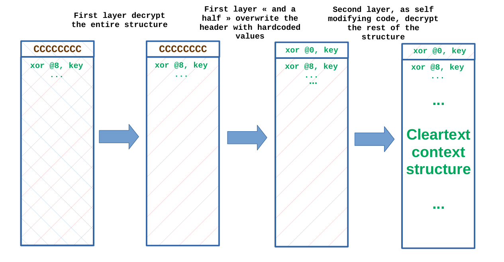
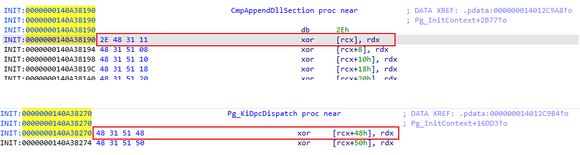

# PgResearch

[English](README_EN.md) | [中文](README.md)

本项目针对 Windows x64 内核 PatchGuard (Kernel Patch Protection, KPP) 机制进行逆向分析、特征检测与绕过研究。经实机验证，在 **Windows 10 家庭中文版 22H2 (OS 内部版本 19045.6466)** 上成功实现稳定绕过（多台机器压测数小时未触发任何 BugCheck 蓝屏）。

## 使用

驱动通过读取注册表项 `HKEY_LOCAL_MACHINE\SYSTEM\CurrentControlSet\Services\PgResearch\Parameters` 获取用户配置。用户可以使用任意加载工具（如系统自带的 `sc.exe` 或第三方加载工具）直接加载驱动，并通过下列注册表项控制驱动行为：

### 1. 注册表配置说明

在注册表路径 `HKLM\SYSTEM\CurrentControlSet\Services\PgResearch\Parameters` 下配置以下项（均为 `REG_DWORD` 类型，1 为开启，0 为关闭）：

- **`ScanEnabled`**（默认值：`1`）：
  控制驱动是否对 **Method 0、1、2、5、7** 以及 **Independent 1、2** 执行静态与调度特征检测，并输出检测报告。
  *注：不包含 Method 3 与 Method 4 的检测，因为这两者无法做到稳定检测，并且遍历全局线程栈非常耗时。*

- **`BypassEnabled`**（默认值：`0`）：
  控制是否开启 **PG 综合绕过**。开启后将同时激活：
  1. **Barricade 硬件通杀**：对 PoolBigPage 与 SystemPtes（Independent Pages）翻转 NX 执行权，并挂钩 `MmAccessFault` 捕获异常，通过超长休眠重定向绕过 Method 3 专用线程与 Method 4 随机 APC，并阻止未背书 RWX 内存中的 PG 执行；
  2. **单独针对各路径的结构体主动处置**：针对 Method 0/1/2 执行 DPC/Timer 脱链与清理、放行 Method 5 平衡集计数器，并对 Method 7（`KiSwInterruptDispatch`）和 Independent 2（`KiMcaDeferredRecoveryService`）下发 `0xC3 (ret)` 热补丁。

- **`TriggerEnabled`**（默认值：`0`）：
  控制是否开启 **Trigger 快速触发测试**。开启后驱动会通过 Inline Hook 修改内核拷贝函数（`ntoskrnl.exe!RtlCompareMemory`），故意破坏内核代码段完整性，用以快速测试 PG 是否会被触发以及上述绕过是否生效。

- **`LogLevel`**（默认值：`0`）：
  控制日志输出级别。`0` 为标准摘要报告（Summary），`1` 为详细调试日志（Verbose）。

---

### 2. 命令行快速使用步骤（复制到 CMD 执行）

以**管理员身份**打开 CMD，按需复制以下命令执行：

```bat
:: 1. 写入注册表配置项 (示例：开启检测 + 开启PG综合绕过)
reg add "HKLM\SYSTEM\CurrentControlSet\Services\PgResearch\Parameters" /v ScanEnabled /t REG_DWORD /d 1 /f
reg add "HKLM\SYSTEM\CurrentControlSet\Services\PgResearch\Parameters" /v BypassEnabled /t REG_DWORD /d 1 /f
reg add "HKLM\SYSTEM\CurrentControlSet\Services\PgResearch\Parameters" /v TriggerEnabled /t REG_DWORD /d 1 /f
reg add "HKLM\SYSTEM\CurrentControlSet\Services\PgResearch\Parameters" /v LogLevel /t REG_DWORD /d 0 /f

:: 2. 创建内核服务 (请将 binPath 替换为 PgResearch.sys 的实际绝对路径)
sc create PgResearch type= kernel start= demand binPath= "C:\path\to\PgResearch.sys"

:: 3. 启动服务 (驱动将读取上述注册表参数生效)
sc start PgResearch

:: 4. 停止服务 (卸载驱动并还原环境)
sc stop PgResearch

:: 5. 删除服务 (清理注册的服务项，彻底移除)
sc delete PgResearch
```

> 提示：在加载驱动前打开 **DebugView**（勾选 `Capture Kernel`）或连接 **WinDbg**，在 DebugView 过滤框输入 `[PgResearch]*` 即可精确捕获所有核心检测报告与拦截日志。

## PatchGuard 初始化路径与调度方式

以下为基于 Windows 10 x64 (19041/19045) 与 Windows 11 (24H2) 内核 `ntoskrnl.exe` 的逆向分析结论速览，用于对照检测报告中的 0、1、2、3、4、5、7 与 Independent1/2：

### 初始化路径

PG 随 `ntoskrnl.exe` 启动初始化，入口隐蔽地分散在多个看似正常的初始化流程中：两条经由启动器 `KiFilterFiberContext`，一条直接调用初始化例程。

#### KeInitAmd64SpecificState（经启动器）

- 反调试：**容忍内核调试模式存在，但要求当前尚未连接内核调试器**。启动器内先调用 `KdDisableDebugger`，再关中断自旋等待 `KdDebuggerNotPresent`。
- 首次 PG 初始化**必定执行**；第二次视首次结果与随机分支（**约 60%**）执行；若前序成功且条件满足，再执行固定 Method 7 的第三次。单次触发内合计**至多三次**初始化。

#### ExpLicenseWatchInitWorker（经启动器）

- 反调试条件同上，另受安全模式与 `KUSER_SHARED_DATA` 调试标志等门槛约束。
- **约 4%** 概率执行一次 PG 初始化。这是**唯一**传入特殊参数 `fiberParam`（取自 `KPRCB.HalReserved[6]`，读后即抹除）的入口；Method 3 / Method 5 依赖该参数，故其实际执行概率以 **4% 为上界**。

#### KiVerifyXcpt15（直接调用，不经启动器）

- 概率执行一次 PG 初始化，**固定以 Method 0 的方式调度**（dpcIndex 仍随机）。本样本实测 **method=0**；旧分析资料记载的 method=1 与本样本不符。

### 调度方式（Method 0–7）

#### Method 0：借道正常 DPC

DPC 触发执行，DPC 的入口函数为下列之一：

| 索引 | DPC 例程 |
| --- | --- |
| 0 | `CmpEnableLazyFlushDpcRoutine` |
| 1 | `ExpCenturyDpcRoutine` |
| 2 | `ExpTimeZoneDpcRoutine` |
| 3 | `ExpTimeRefreshDpcRoutine` |
| 4 | `CmpLazyFlushDpcRoutine` |
| 5 | `ExpTimerDpcRoutine` |
| 6 | `IopTimerDispatch` |
| 7 | `IopIrpStackProfilerDpcRoutine` |
| 8 | `KiBalanceSetManagerDeferredRoutine` |
| 9 | `PopThermalZoneDpc` |
| 10–12 | `KiTimerDispatch` 或 `KiDpcDispatch` |

这些 DPC 函数本身是常见的正常函数，各有自身职责；PG 通过参数指示其参与 PG：若参与 PG，则其 `DeferredContext` 参数存储的是一个**非规范地址（non-canonical address）**。

值得重点关注的是，该 `KTIMER` 对象的 `Period` 字段被显式设为 **0**，`DueTime` 则为一个**约 2 分钟的随机延迟**；例程自身会在退出前重新计算并挂入下一个随机定时器。通过这种“**单次触发、重算下一次**”的链式延迟调度，PG 避免了固定周期定时器可被预测和拦截的特征。

#### Method 1 / 2：寄生 PRCB 保留字段

DPC 分别被写入当前 CPU 的 `KPRCB.AcpiReserved`（Method 1）或 `KPRCB.HalReserved[7]`（Method 2）字段，在发生某些 **ACPI 事件**（例如进入空闲状态）、**HAL 定时器时钟中断**时被调用执行。

#### Method 3：专用系统线程

执行环境不满足时退化为 Method 0（该退化路径尚未完全确证），实际执行概率**约 4%，只会更低**。

创建一个系统专用线程，线程入口是调用真实验证函数的 stub 函数。为防止通过 `ETHREAD` 的 `StartAddress` 与 `Win32StartAddress` 字段识别 PG 线程，线程创建后 PG 会将这两个字段**改写为正常/常见的函数地址**。

该工作线程依靠以下三套延时调度 API 维持**约 2 分钟**的检测周期：`KeDelayExecutionThread`、`KeWaitForSingleObject`、`KeWaitForMultipleObjects`。

#### Method 4：随机线程 APC

PG 从满足要求的系统线程中**随机选择一个**（线程起始函数是 `PopIrpWorkerControl`），向其插入内核 APC；该 APC 同样会调用 `KeDelayExecutionThread`、`KeWaitForSingleObject`、`KeWaitForMultipleObjects` 主动休眠与延时以维持**约 2 分钟**的检测间隔。

> 线程必须满足要求的原因：**某些关键线程不能被暂停**，因此不能随便选一个系统线程。

#### Method 5：HOOK 平衡集管理器 DPC

执行要求不满足时退化为 Method 0，实际执行概率同样**约 4%（只会更低）**。

该分支修改全局变量 `KiBalanceSetManagerPeriodicDpc` 指向的 DPC 为 PG 逻辑，在实现 HOOK 的同时内部维护一个计数器：计数归零前均放行原本的逻辑；**一旦计数清零，就执行 PG 的检查逻辑**并重置计数器。该 DPC 的执行频率**约为 1 Hz**，因此计数器取值**约 120（对应 2 分钟）**。

#### Method 6：未启用 / 未观测

**从未观测到** `method == 6` 的情况，暂不需要考虑。

#### Method 7：初始化全局上下文

在 `KiFilterFiberContext` 末尾可以看到固定 Method 7 的 PG 初始化调用。综合分析该分支的执行条件，只要开启了“基于虚拟化的安全性（VBS / Hyper-V / VSM）”机制，该初始化**必然被执行**，反之则不执行。

Method 7 的核心价值是**初始化全局变量 `MaxDataSize`（即全局 PG Context 指针）**，供隐藏在海量系统 API 中的若干检测点消费。例如 `KiSwInterruptDispatch` **不判断该指针是否为空**，直接在中断上下文中解引用该变量并执行 PG 检查。

### 独立检测机制（Independent，均利用 DPC）

#### CcInitializeBcbProfiler（报告中的 Independent1）

系统利用 `CcInitializeBcbProfiler` 以隐蔽方式执行检查：该函数先计算一个**随机 ntoskrnl 例程**的校验和，然后设置一个以 `CcBcbProfiler` 为例程的 DPC，让其**定期检测指定例程是否被修改**；该 DPC 在执行末尾会重新设置自己**隔约 2 分钟**再次执行。被设置的 DPC 例程也可能是另一个逻辑几乎一模一样的相似函数 `CcBcbProfiler2`（原本无符号名）。

#### 零星业务插桩（报告中的 Independent2）

系统中还零星散落着若干具有自主检测行为的函数，例如：

1. `PspProcessDelete`：检查 **SSDT 与 shadow SSDT** 的完整性；
2. `KiInitializeUserApc`：检查 **IDT** 的完整性。

除上述两处外，内核中还散落着若干类似检查。它们在行使自身合法的内核主营业务前夕，顺带执行**极其轻量化的安全插桩检测**。特点是当侦测到系统异常时，统一通过**插入 DPC** 的方式调用 `KiMcaDeferredRecoveryService` 来触发蓝屏。

与 PG 主体触发蓝屏使用的 `SdbpCheckDll` 及 `CcAdjustBcbDepth` 类似，`KiMcaDeferredRecoveryService` 在触发 `KeBugCheckEx` 之前也会**强制清空栈帧**；但在调用 `SdbpCheckDll` 和 `CcAdjustBcbDepth` 的位置，系统默认不会返回，并在 call 指令后方插入 `JUMPOUT` 等无法执行的指令以防绕过，而调用 `KiMcaDeferredRecoveryService` 的位置**遗漏了该防御机制**。因此，对使用该函数触发蓝屏的检测，**可以通过 Patch 绕过**。

### 基于内存特征的 PG 通杀

Method 0、1、2、5 使用的 DPC 是自插入：在检测末尾会重新将自己挂入/恢复到相应字段，从执行到重新挂入存在时间差，所以未必能检测到。

另外，要绕过 Method 4，可以和绕过 Method 3 一样检测被挂起的系统线程调用栈是否存在上述 3 种等待函数的调用，如果有则注入 APC 永久挂起，但是这样可能误伤有实际意义的系统线程并且搜索逻辑很复杂。

综上所述，一种更好的通杀方案是利用 PG Context 的特征：

1. 内存页在 Pool（大页池）或 Independent（独立页面）中分配，且内存页同时具备 RWX（可读、可写、可执行）权限（这在现代 Windows 10/11 内核中极为罕见）。

2. PG Context 的入口函数为三者之一：`CmpAppendDllSection`、`KiDpcDispatch` 或 `KiTimerDispatch`。
   > 补充：这三个函数的名称都是伪装，对其交叉引用，仅能在 PG 初始化函数中找到对其引用。

   - **`CmpAppendDllSection` 与 `KiDpcDispatch` 具有自解密逻辑**：
     
     解密逻辑参看下图（红蓝斜线表示是否为明文）：
     
     
     
     因此两个函数被执行时只能看到在 IDA 中看到的第一条指令特征码，分别是 `2E 48 31 11` 和 `48 31 51 48`（这已足够精确定位，使用 xor 指令作为函数开头的内核例程极为罕见）：
     
     

   - **`KiTimerDispatch` 没有自解密逻辑**，特征码可以提取更长以保证绝对正确性。

因此，通过定向扫描 Pool（大页池）与 Independent（独立页面）分配的内存，锁定具有 RWX 权限的页面并通过剥夺执行权（置 NX 位）进行布防。当因执行被摘权页面触发缺页异常时，捕获异常并检测入口特征码是否命中上述伪装函数。若满足，则直接处置以阻止 PG 检测逻辑执行，实现通杀。

补充：对于 Method 3 和 Method 4，其执行实体并非上述三个伪装函数，而是随机系统线程或内核 APC。针对此类实体，可通过缺页异常拦截发生时的调用栈回溯（栈泄露查找等待函数）进行精准识别，并将其重定向至超长休眠，从而阻止其检测。

## 参考

该项目的开发离不开开源资料和项目的支持。开源资料与项目中所介绍的机制通常仅在特定相近版本上可完全复现，但即使如此，早期资料对研究现代 Windows 内核 PG 机制依然具有不可替代的启发价值：

**文章：**
- [Satoshi's note: Some Tips to Analyze PatchGuard](https://standa-note.blogspot.com/2015/10/some-tips-to-analyze-patchguard.html)
- [Updated Analysis of PatchGuard on Microsoft Windows 10 RS4](https://blog.tetrane.com/downloads/Tetrane_PatchGuard_Analysis_RS4_v1.01.pdf)
- [PatchGuard Internals | r0keb](https://r0keb.github.io/posts/PatchGuard-Internals/?utm_source=chatgpt.com#context-initialization)
- [Windows 11 24H2 Kernel Patch Protection Analysis - HackMD](https://hackmd.io/p59VZ9BuR8C3IR6mTG-6uA#Static-Analysis)

**代码：**
- [zzhouhe/PG1903](https://github.com/zzhouhe/PG1903/tree/master)
- [NeoMaster831/kurasagi: Windows 11 24H2-25H2 Runtime PatchGuard Bypass](https://github.com/NeoMaster831/kurasagi)
