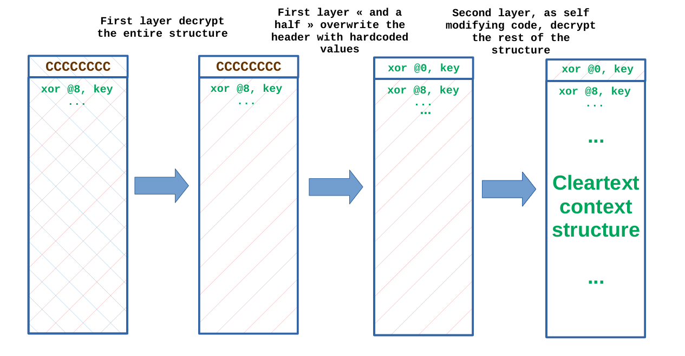
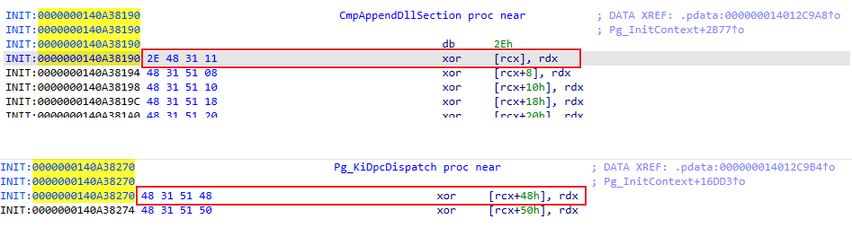

# PgResearch

[English](README_EN.md) | [中文](README.md)

A research project focused on Windows x64 Kernel Patch Protection (PatchGuard / KPP) reverse engineering, characteristic detection, and runtime bypass mechanisms. Verified on **Windows 10 Home China Version 22H2 (OS Build 19045.6466)**, achieving stable runtime bypass across multi-machine stress tests lasting several hours without triggering BugCheck crashes.

## Usage

The driver reads its configuration from the registry key:  
`HKEY_LOCAL_MACHINE\SYSTEM\CurrentControlSet\Services\PgResearch\Parameters`.

You can load the driver using any standard driver loading utility (such as the native `sc.exe` or third-party tools) and control driver behavior via the following registry values:

### 1. Registry Configuration

Configure the following values under `HKLM\SYSTEM\CurrentControlSet\Services\PgResearch\Parameters` (all are `REG_DWORD` types, where `1` = Enabled, `0` = Disabled):

- **`ScanEnabled`** (Default: `1`):  
  Controls whether the driver performs static and scheduling feature detection for **Method 0, 1, 2, 5, 7** and **Independent 1, 2**, and outputs a diagnostic report.  
  *Note: Detection for Method 3 and Method 4 is omitted due to the inability to achieve deterministic scanning and the heavy overhead of traversing global thread stacks.*

- **`BypassEnabled`** (Default: `0`):  
  Controls whether **comprehensive PG bypass** is enabled. When enabled, it activates:  
  1. **Barricade Hardware Generic Bypass**: Strips execution rights (sets NX bit) on unbacked PoolBigPage and SystemPtes (Independent Pages) allocations, hooks `nt!MmAccessFault` to intercept page faults, redirects Method 3 dedicated threads and Method 4 random APC execution entities to long sleep loops, and prevents PG execution from unbacked RWX pages;  
  2. **Individual Structural Neutralization**: Unlinks and neutralizes DPC/Timer structures for Methods 0/1/2, maintains balancer counter pass-through for Method 5, and applies `0xC3 (ret)` hotpatches to Method 7 (`KiSwInterruptDispatch`) and Independent 2 (`KiMcaDeferredRecoveryService`).

- **`TriggerEnabled`** (Default: `0`):  
  Controls whether **Trigger Rapid Detection Test** is enabled. When enabled, the driver hooks the kernel memory comparison routine (`ntoskrnl.exe!RtlCompareMemory`) to intentionally corrupt kernel code segment integrity, rapidly verifying whether PG triggers and whether the bypass is effective.

- **`LogLevel`** (Default: `0`):  
  Controls debug log verbosity. `0` = Standard Summary report; `1` = Verbose diagnostic details.

---

### 2. Quick Command-Line Instructions (Run in CMD as Administrator)

Open Command Prompt as **Administrator** and run the following commands as needed:

```bat
:: 1. Write registry configuration (Example: Enable Scan + Enable Comprehensive Bypass)
reg add "HKLM\SYSTEM\CurrentControlSet\Services\PgResearch\Parameters" /v ScanEnabled /t REG_DWORD /d 1 /f
reg add "HKLM\SYSTEM\CurrentControlSet\Services\PgResearch\Parameters" /v BypassEnabled /t REG_DWORD /d 1 /f
reg add "HKLM\SYSTEM\CurrentControlSet\Services\PgResearch\Parameters" /v TriggerEnabled /t REG_DWORD /d 0 /f
reg add "HKLM\SYSTEM\CurrentControlSet\Services\PgResearch\Parameters" /v LogLevel /t REG_DWORD /d 0 /f

:: 2. Create the kernel service (Replace binPath with the absolute path to PgResearch.sys)
sc create PgResearch type= kernel start= demand binPath= "C:\path\to\PgResearch.sys"

:: 3. Start the service (The driver will load and apply registry settings)
sc start PgResearch

:: 4. Stop the service (Unloads the driver and restores clean state)
sc stop PgResearch

:: 5. Delete the service (Completely removes the service registration)
sc delete PgResearch
```

> **Tip**: Before loading the driver, launch **DebugView** (ensure `Capture Kernel` is checked) or attach **WinDbg**. Set the filter to `[PgResearch]*` to capture all detection tables, mitigation actions, and interception logs without noise.

## PatchGuard Initialization Paths & Dispatch Mechanisms

The following summary is derived from reverse engineering Windows 10 x64 (19041/19045) and Windows 11 (24H2) kernel `ntoskrnl.exe`, corresponding to rows 0, 1, 2, 3, 4, 5, 7 and Independent 1/2 in the scan report:

### Initialization Paths

PatchGuard initializes during `ntoskrnl.exe` startup. Its entry points are covertly scattered across seemingly standard initialization routines: two via the launcher routine `KiFilterFiberContext`, and one invoked directly.

#### KeInitAmd64SpecificState (Via Launcher)

- **Anti-Debugging**: Tolerates kernel debugging mode enabled at boot, but requires that **no kernel debugger is currently attached**. The launcher first calls `KdDisableDebugger`, then disables interrupts and spins waiting for `KdDebuggerNotPresent`.
- The first PG initialization is **guaranteed to execute**; the second executes based on the first outcome and a random branch (**~60%**); if preceding steps succeed and criteria are met, a third initialization fixed to Method 7 executes. A single boot trigger yields **at most three** initialization passes.

#### ExpLicenseWatchInitWorker (Via Launcher)

- Subject to the same anti-debugging conditions, plus Safe Mode and `KUSER_SHARED_DATA` debugging flag constraints.
- Executes one PG initialization with an **approximate 4%** probability. This is the **only** entry point that passes the special `fiberParam` parameter (retrieved from `KPRCB.HalReserved[6]` and wiped immediately after reading); Method 3 and Method 5 depend on this parameter, meaning their runtime occurrence is **upper-bounded at 4%**.

#### KiVerifyXcpt15 (Direct Call, Bypassing Launcher)

- Probabilistically executes one PG initialization, **fixed to Method 0 dispatching** (`dpcIndex` remains randomized). Verified as **Method 0** in this sample; older research attributing Method 1 to this path does not match this kernel build.

### Dispatch Mechanisms (Method 0–7)

#### Method 0: Borrowing Legitimate DPCs

Triggered via DPC execution. The DPC routine is randomly selected from one of the following:

| Index | DPC Routine |
| --- | --- |
| 0 | `CmpEnableLazyFlushDpcRoutine` |
| 1 | `ExpCenturyDpcRoutine` |
| 2 | `ExpTimeZoneDpcRoutine` |
| 3 | `ExpTimeRefreshDpcRoutine` |
| 4 | `CmpLazyFlushDpcRoutine` |
| 5 | `ExpTimerDpcRoutine` |
| 6 | `IopTimerDispatch` |
| 7 | `IopIrpStackProfilerDpcRoutine` |
| 8 | `KiBalanceSetManagerDeferredRoutine` |
| 9 | `PopThermalZoneDpc` |
| 10–12 | `KiTimerDispatch` or `KiDpcDispatch` |

These DPC routines are legitimate operating system functions with standard responsibilities. PG indicates their participation in validation via parameters: when participating, their `DeferredContext` parameter holds a **non-canonical address**.

Notably, the associated `KTIMER` object has its `Period` field explicitly set to **0**, while `DueTime` is set to a **random delay of ~2 minutes**. The routine recalculates and re-queues the next random timer just before exiting. Through this "single-shot fire and re-queue" chain, PG eliminates predictable periodic timer patterns that could otherwise be trivially trapped.

#### Method 1 / 2: Parasitizing PRCB Reserved Slots

DPC pointers are placed into the current CPU's `KPRCB.AcpiReserved` (Method 1) or `KPRCB.HalReserved[7]` (Method 2) fields, executed when specific **ACPI events** (such as entering idle states) or **HAL timer clock interrupts** occur.

#### Method 3: Dedicated System Thread

Falls back to Method 0 when operating conditions are not met (this fallback path is unverified in all environments); actual execution probability is **~4% or lower**.

Creates a dedicated system thread whose entry routine is a stub invoking validation logic. To prevent detection via `ETHREAD.StartAddress` and `Win32StartAddress`, PG **rewrites both fields with legitimate system routine addresses** immediately after thread creation.

The worker thread maintains its **~2 minute** detection interval using three wait APIs: `KeDelayExecutionThread`, `KeWaitForSingleObject`, and `KeWaitForMultipleObjects`.

#### Method 4: Random Thread APC

PG **randomly selects an eligible system thread** (specifically targeting threads whose initial routine is `PopIrpWorkerControl`) and queues a kernel APC. This APC similarly invokes `KeDelayExecutionThread`, `KeWaitForSingleObject`, or `KeWaitForMultipleObjects` to sustain an **approximate 2-minute** delay cycle.

> **Rationale**: Critical OS threads cannot be safely paused, necessitating strict eligibility filtering before selection.

#### Method 5: Hooking Balance Set Manager DPC

Falls back to Method 0 if requirements are unmet; execution probability is **~4% or lower**.

Modifies the DPC pointed to by the global variable `KiBalanceSetManagerPeriodicDpc` to point to PG logic. While hooking, it maintains an internal countdown: original logic passes through until the counter reaches zero; **once zeroed, it executes PG verification** and resets the counter. The DPC fires at **~1 Hz**, with a counter threshold of **~120 (corresponding to 2 minutes)**.

#### Method 6: Disabled / Unobserved

A value of `method == 6` has **never been observed** in telemetry or kernel reverse engineering and requires no mitigation.

#### Method 7: Initializing Global Context

A fixed Method 7 initialization call is positioned at the tail of `KiFilterFiberContext`. Comprehensive analysis reveals that whenever Virtualization-Based Security (VBS / Hyper-V / VSM) is active, this initialization **always executes**; otherwise, it is skipped.

The primary purpose of Method 7 is **initializing the global variable `MaxDataSize` (the global PG Context pointer)**, consumed by numerous verification points distributed across core system APIs. For example, `KiSwInterruptDispatch` directly dereferences `MaxDataSize` in interrupt context without null-checking to perform PG checks.

### Independent Detection Mechanisms (DPC-Based)

#### CcInitializeBcbProfiler (Independent 1 in Report)

The system leverages `CcInitializeBcbProfiler` to perform stealth checks: it computes a checksum over a **random ntoskrnl routine**, then configures a DPC pointing to `CcBcbProfiler` to **periodically verify whether the routine has been tampered with**. The DPC re-arms itself for another check **after ~2 minutes** before exiting. The registered DPC routine may also be an identical twin function, `CcBcbProfiler2` (originally unnamed in private symbols).

#### Ad-hoc Security Stubs (Independent 2 in Report)

Scattered throughout the kernel are functions that perform autonomous security validation prior to executing their standard tasks, such as:

1. `PspProcessDelete`: Verifies the integrity of the **SSDT and Shadow SSDT**;
2. `KiInitializeUserApc`: Verifies the integrity of the **IDT**.

Beyond these two locations, several similar routines exist across kernel subsystems. When an anomaly is detected, they queue a DPC targeting `KiMcaDeferredRecoveryService` to trigger a BugCheck.

Similar to `SdbpCheckDll` and `CcAdjustBcbDepth` used by main PG bodies, `KiMcaDeferredRecoveryService` **wipes stack frames** before calling `KeBugCheckEx`. However, while `SdbpCheckDll` and `CcAdjustBcbDepth` append `JUMPOUT` and non-executable padding after the call to prevent continuation, the call site in `KiMcaDeferredRecoveryService` **omits this defense**. Consequently, checks utilizing this path **can be defeated via inline patching**.

### Generic Bypass via Memory Characteristics

Methods 0, 1, 2, and 5 employ self-reinserting DPCs: there is a timing gap between execution and re-queuing during which active DPC pointers are absent from inspection slots.

Furthermore, defeating Method 4 via stack inspection (similar to Method 3) by enumerating suspended system threads for wait APIs and injecting permanent sleep APCs introduces risks of collateral impact to benign system threads and high scanning complexity.

A superior, generic solution exploits the universal memory characteristics of PG contexts:

1. Context memory pages reside in **PoolBigPage** (Large Pool) or **SystemPtes** (Independent Pages), and the pages simultaneously possess **RWX (Read-Write-Execute)** permissions (an anomaly in modern Windows 10/11 kernels).

2. The PG context entry point is consistently disguised as one of three routines: `CmpAppendDllSection`, `KiDpcDispatch`, or `KiTimerDispatch`.
   > Note: These function names are disguises; xref analysis reveals they are referenced solely from PG initialization code.

   - **`CmpAppendDllSection` and `KiDpcDispatch` feature self-decryption**:
     
     The decryption layout is shown below (red/blue markers distinguish ciphertext vs. plaintext):
     
     
     
     Consequently, only the very first instruction opcode is visible prior to execution: `2E 48 31 11` and `48 31 51 48` respectively (this provides sufficient precision, as starting a kernel function with an XOR instruction is extremely rare):
     
     

   - **`KiTimerDispatch` lacks self-decryption**, allowing longer signature matching for guaranteed accuracy.

Therefore, by scanning PoolBigPage allocations and SystemPtes, unbacked RWX pages are identified and stripped of execution rights (setting the hardware NX bit). When execution of an NX-flagged page triggers a `#PF` page fault, the exception handler intercepts execution, verifies entry point signatures, and neutralizes execution to completely prevent PG checks from executing.

**Note on Methods 3 & 4**: Their execution entities do not enter through the three disguised routines, but rather run as arbitrary system threads or kernel APCs. For these entities, page fault interception analyzes the faulting TrapFrame call stack to identify wait functions (`KeDelayExecutionThread`, etc.) and redirects thread context to indefinite sleep loops.

## References

This research builds upon invaluable insights from the security community and public research. While specific offsets and implementations vary across Windows releases, historical analyses remain foundational to dissecting modern PatchGuard:

**Articles:**
- [Satoshi's note: Some Tips to Analyze PatchGuard](https://standa-note.blogspot.com/2015/10/some-tips-to-analyze-patchguard.html)
- [Updated Analysis of PatchGuard on Microsoft Windows 10 RS4](https://blog.tetrane.com/downloads/Tetrane_PatchGuard_Analysis_RS4_v1.01.pdf)
- [PatchGuard Internals | r0keb](https://r0keb.github.io/posts/PatchGuard-Internals/?utm_source=chatgpt.com#context-initialization)
- [Windows 11 24H2 Kernel Patch Protection Analysis - HackMD](https://hackmd.io/p59VZ9BuR8C3IR6mTG-6uA#Static-Analysis)

**Code:**
- [zzhouhe/PG1903](https://github.com/zzhouhe/PG1903/tree/master)
- [NeoMaster831/kurasagi: Windows 11 24H2-25H2 Runtime PatchGuard Bypass](https://github.com/NeoMaster831/kurasagi)
